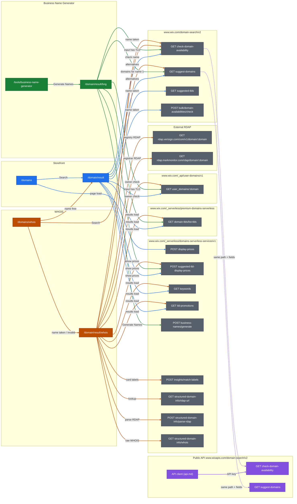

# Architecture: four doors to "Can I get this name?"

Sources: HARs in `docs/har/raw` (named `storefront-flow1` … `whois-flow3`, local, not committed), scenario notes in `docs/scenarios/`, `docs/api-reference.md`, `docs/scenarios/api.md`.
All web flows were recorded signed out, Israel, ₪ (scenario note headers). Hosts are `www.wix.com` unless stated otherwise.

**Limits of the evidence.** The HARs hold fetch/XHR entries only: no document or `<script>` entries. Tech clues therefore come from fetched resources and the `server` / `via` response headers. Every Wix route answered with `server: Pepyaka` and `via: 1.1 google` (all HARs).

## 1. Domain storefront

**Made of:** entry page `/domains` and results page `/domain/result` (HAR page titles, `storefront-flow1..3`).
- Entry page fetches `siteassets.parastorage.com/pages/pages/thunderbolt`, `bundler-velo.parastorage.com/…`, `/domains/_api/v1/access-tokens` and manifests from `static.parastorage.com/services/editor-elements/…` (`storefront-flow1`). **Assumption:** this is a page built in the Wix site editor, rendered by Thunderbolt, with Velo code.
- The results page makes none of those calls (`storefront-flow1`). Its markup uses `wds-*` / `wds_1_343_0-*` classes (storefront note, flow 1). **Assumption:** the results page is a separate client-side app built with the Wix Design System.

**Calls, in flow order:**

| Page | Call | Status | Drives on screen |
|---|---|---|---|
| entry | `POST /_serverless/domains-serverless-services/v1/display-prices` (payload `a.com`, `a.net`, … ×6) | 200 | **Assumption:** prices on the landing page. Not in the notes; the response body was not saved. |
| results | `GET /_serverless/premium-domains-serverless/domain-tlds/list-tlds` | 200 | **Assumption:** TLD rules (414 TLDs; fields `privacySupport`, `registrar` = `TUCOWS`, …). Nothing visible matches. |
| results | `POST /_serverless/domains-serverless-services/v1/suggested-tld-display-prices` (payload `{}`) | 200 | `displayPrices[].pricing` `originalPrice` ₪21.47, `price` ₪0.00, `FREE_FIRST_YEAR` → "₪21.47/yr", "₪0.00/yr", "Free for 1 year" on the hero card (flow 2 note). |
| results | `GET /domain-search/v2/check-domain-availability` | 200 / 400 | `available:false` → "google.com is already registered…" (flow 1). `available:true` → "Available now!" badge and the "Make It Yours" button (flow 2). 400 `INVALID_DOMAIN` → ".test domains aren’t available…" (flow 3). Called twice in `storefront-flow3`. |
| results | `GET /domain-search/v2/suggest-domains` | 200 | `suggestions[].domain` → the alternatives list `recommendations-content-list-item-N` (flow 1 note; first item `thegoogle.biz` in the HAR). |
| results | `GET /_api/user-domains/v1/user_domains/<domain>` | 401 `DOMAINS_UNAUTHENTICATED` | Nothing visible. **Assumption:** checks whether the visitor already owns the domain. |
| results | `GET /domain-search/v2/suggested-tlds` (flow 1 only) | 200 | `tlds[]` (13: com, net, co.il, …). **Assumption:** the TLDs for the other-extensions check below. |
| results | `POST /domain-search/v2/bulk/domain-availabilities/check` ×3 (flow 1 only, 60 domains each: `google.net`, `google.care`, …) | 200 | `results[].item.available` and the other fields of the single check. **Assumption:** other extensions of a taken name. Not in the notes. |
| results | `GET /_serverless/domains-serverless-services/v1/keywords` | 200 | `keywords[]` was empty. Nothing visible. |
| results | `GET /_serverless/domains-serverless-services/v1/tld-promotions` | 200 | `tldPromotions[].description` ("Most popular domain for…"). It does **not** match the hero-card feature lines in the flow 2 note. **Assumption:** promo copy shown elsewhere. |

## 2. Business Name Generator

**Made of:** entry page `/tools/business-name-generator` and results page `/domain/result/bng` (`generator-flow1..3`). The entry page makes the same Thunderbolt / Velo / `access-tokens` calls as the storefront (**Assumption:** a Wix-editor page). The results page is under the same `/domain/result` path as the storefront's results page and uses the same `recommendations-content-list-item-N` hook (generator note, flow 1). **Assumption:** it is the same results app in a "bng" mode.

**Calls (all on the results page, after "Generate Names"):**

| Call | Status | Drives on screen |
|---|---|---|
| `GET …/premium-domains-serverless/domain-tlds/list-tlds` | 200 | as storefront (**Assumption**) |
| `POST /_serverless/domains-serverless-services/v1/business-names/generate` (payload `query`, `excluding[]`, `count: 9`) | 200 | `businessNames[].name`, `.reasoning` (e.g. Zygo, Jumblify, Bakerya). **Assumption:** the names list. The notes only say "list of suggestions". |
| `POST …/suggested-tld-display-prices` | 200 | **Assumption:** prices. The notes don't record prices for this door. |
| `GET /domain-search/v2/suggest-domains` | 200 | Domain suggestions list. In flow 2 the query is the first generated name, `Jumblify` (generator note, flow 2). |
| `GET /domain-search/v2/check-domain-availability` and `GET /_api/user-domains/v1/user_domains/<domain>` (flow 3 only, input `mybakery.test`) | 400 / 401 | Nothing specific noted ("list of suggestions"). **Assumption:** these run only when the input looks like a domain. |

No availability check runs for generated names in flows 1–2 (`generator-flow1`, `generator-flow2`). This matches the note "no indication for availability" (flow 1, step 6).

## 3. WHOIS lookup

**Made of:** entry page `/domains/whois`, which also makes the Thunderbolt / Velo / `access-tokens` calls (**Assumption:** a Wix-editor page). Then one of two results pages:
- `/domain/result/whois` when the name is taken or invalid (`whois-flow1`, `whois-flow3`).
- The storefront's `/domain/result` when the name is free (`whois-flow2`). For an invalid name the flow goes on to `/domain/result` too (`whois-flow3`).

**Calls:**

| Page | Call | Status | Drives on screen |
|---|---|---|---|
| entry | `GET /domain-search/v2/check-domain-availability` (response body not saved) | 200 / 400 | **Assumption:** chooses the results page (taken → `/result/whois`, free → `/result`). |
| result/whois | `GET /_serverless/domains-serverless-services/v1/structured-domain-info/rdap-url` | 200 | `url` = `https://rdap.verisign.com/com/v1/` (no visible text) |
| result/whois | `GET rdap.verisign.com/com/v1/domain/<domain>`, then `GET rdap.markmonitor.com/rdap/domain/<DOMAIN>`: the **browser** calls external RDAP servers | 200 | raw RDAP JSON, posted to the next call |
| result/whois | `POST …/structured-domain-info/parse-rdap` ×2 (payload = the RDAP JSON) | 200 | `info.domainInfo.created/updated/expires` 1997-09-15 / 2019-09-09 / 2028-09-14, `nameservers[4]`, `status[6]`, `registrar.name` MarkMonitor Inc., `registrant.redacted:true` → the "Domain Information", "Registrar Information" and "—" registrant fields (flow 1 note). One-to-one. **Assumption:** the 2nd parse (`tos.text` "By submitting an RDAP query…") feeds the Markmonitor "Terms of Service" block. |
| result/whois | `GET …/structured-domain-info/whois` | 200 / 500 | `info.raw.registry`, `info.raw.registrar` → **Assumption:** the "Raw Registry / Registrar WHOIS Data" accordions. Flow 3: 500 `UNABLE_TO_LOOKUP_WHOIS`. |
| result/whois | `check-domain-availability`, `list-tlds`, `user_domains/<domain>` (401), `keywords`, `tld-promotions`: as storefront | | `available:false` → "google.com is registered…" (flow 1 note) |
| result/whois | `GET /domain-search/v2/suggest-domains` (5 results) | 200 | the 5 alternative cards `googlerecords.com`, `realgoogle.net`, … (flow 1 note). One-to-one. |
| result/whois | `POST …/suggested-tld-display-prices` | 200 | com ₪21.47, net ₪40.73, biz ₪27.44, info ₪67.85 → ₪0.00. Matches the cards (flow 1 note). |
| result/whois | `POST /_serverless/domains-serverless-services/v1/insights/match-labels` (payload: 5 domains + 10 candidate labels) | 200 | `labels[].label` → card badges: `MOST_POPULAR` "Most Popular", `IDEAL_FOR_SMALL_BUSINESSES`, `BEST_FOR_ECOMM`, `READY_TO_GROW` match. `TRUSTED_AND_RELIABLE` is shown as "Great Alternative": **mismatch**. |

## 4. Public Domain Availability API

`GET https://www.wixapis.com/domain-search/v2/check-domain-availability?domain=…` with an account API key (`docs/api-reference.md`). Results we saw (`docs/scenarios/api.md`):
- `google.com` → 200, `available:false`
- `sdfsjgghg.com` → 200, `available:true`
- `sdfsjgghg` and `mybakery.test` → 400 `INVALID_DOMAIN`, "failed to extract root domain from …, a tld is missing or invalid"

The same docs page has Suggest Domains at `/domain-search/v2/suggest-domains`. It was not exercised.

## Relations

**Between web doors**
- **Shared calls (all three doors):** `suggest-domains`, `suggested-tld-display-prices`, `list-tlds` (HARs, all doors).
- **Shared by storefront and WHOIS:** `check-domain-availability`, `user_domains/<domain>`, `keywords`, `tld-promotions` (HARs). The generator makes the check and `user_domains` calls only in flow 3 (`generator-flow3`).
- **Door-specific:** storefront has `suggested-tlds`, `bulk/domain-availabilities/check` and entry `display-prices`. Generator has `business-names/generate`. WHOIS has `structured-domain-info/*`, `insights/match-labels` and external RDAP.
- **Shared pages:** WHOIS hands free names to the storefront's `/domain/result` (`whois-flow2`). Generator and WHOIS results pages live under `/domain/result/*` (HAR page titles). All three entry pages share the Thunderbolt / Velo / `access-tokens` pattern.
- **Shared services:** `domains-serverless-services` backs all three; `/domain-search/v2` backs all three.

**Web doors vs. the public API**
- Web route `www.wix.com/domain-search/v2/check-domain-availability` and the public `www.wixapis.com/domain-search/v2/check-domain-availability` have the same path and return the same body for the same inputs. Compare `storefront-flow1/2/3` with `api.md` rows 1, 2, 4: same fields, same values, same 400 message. **Assumption:** one backend service behind two gateways. Auth headers were not inspected.
- Web `suggest-domains` returns exactly the documented fields (`suggestions[].domain`, `.premium`, `pagingMetadata.count/.cursors.next/.hasNext`; `docs/api-reference.md`). **Assumption:** same service as public Suggest Domains.
- `bulk/domain-availabilities/check`, `suggested-tlds` and all price, WHOIS and generator calls are not in `docs/api-reference.md`. The public API returns no price (docs), so every price on screen comes from `domains-serverless-services`.
- **Doc gap:** every response returns `premiumType: "UNKNOWN_PREMIUM_TYPE"` for non-premium names: web HARs and `api.md`. The docs list only `FIRST_YEAR_ONLY` / `FIRST_YEAR_AND_RENEWAL`. This also settles the open point in `api-reference.md`: the premium fields are present, not omitted.

**Notes vs. HAR gaps (HAR followed)**
- Storefront note flow 1 misses `list-tlds`, `bulk/…/check` ×3, `keywords`, `tld-promotions` and the entry `display-prices`. Flows 2–3 miss `keywords` and `tld-promotions`.
- Generator note flow 1 misses `list-tlds` and `suggest-domains`; flow 3 misses `suggest-domains`. None of the generator notes record the results page `/domain/result/bng`.
- WHOIS note flow 1 lists no calls and no navigation. The HAR shows `/domain/result/whois` and the RDAP chain. WHOIS note flow 3 says it redirected to `/domain/result`; the HAR shows `/domain/result/whois` first (where the 500 happens), then `/domain/result`.
- `whois-flow1` starts with a leftover `/domain/result` page from the previous recording. That's a recording artefact; it was ignored.

## Diagram

Solid = observed in a HAR or `api.md`; dotted = Assumption. Page→page edges are navigation. Every other edge is one call. `getUserDetails` and the entry-page site-loader calls are left out, since they aren't domain logic.

